<picture>
  <source media="(prefers-color-scheme: dark)" srcset="https://raw.githubusercontent.com/oGusz/oGusz/main/assets/header-dark.svg">
  
</picture>

<picture>
  <source media="(prefers-color-scheme: dark)" srcset="https://raw.githubusercontent.com/oGusz/oGusz/main/assets/stack-dark.svg">
  
</picture>

<a href="https://github.com/oGusz/SimpleFinan">
  <picture>
    <source media="(prefers-color-scheme: dark)" srcset="https://raw.githubusercontent.com/oGusz/oGusz/main/assets/simplefinan-dark.svg">
    
  </picture>
</a>

  <a href="https://github.com/oGusz?tab=repositories">Ver todos os repositórios →</a>

<!--
Contato: descomente e troque SEU-USUARIO pelo seu LinkedIn.

  

-->
